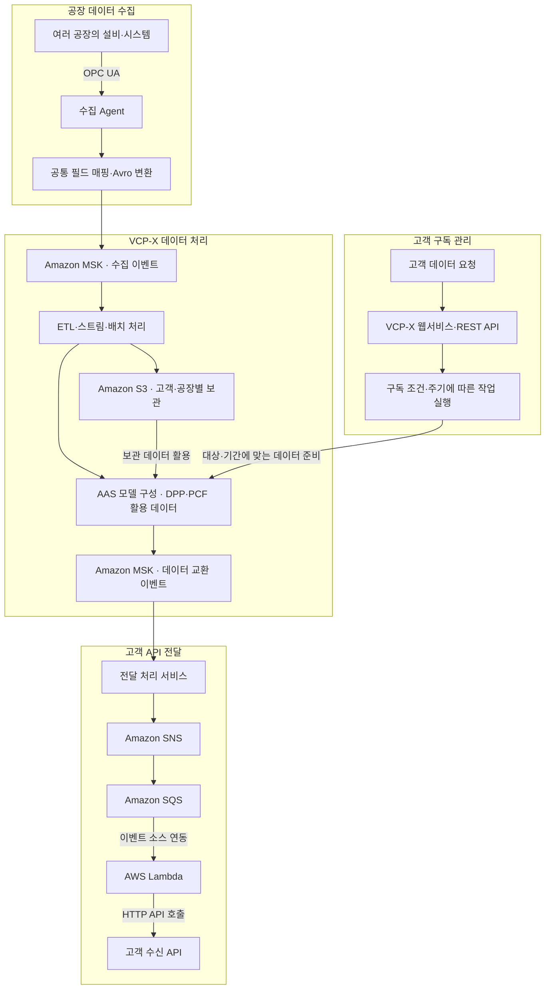
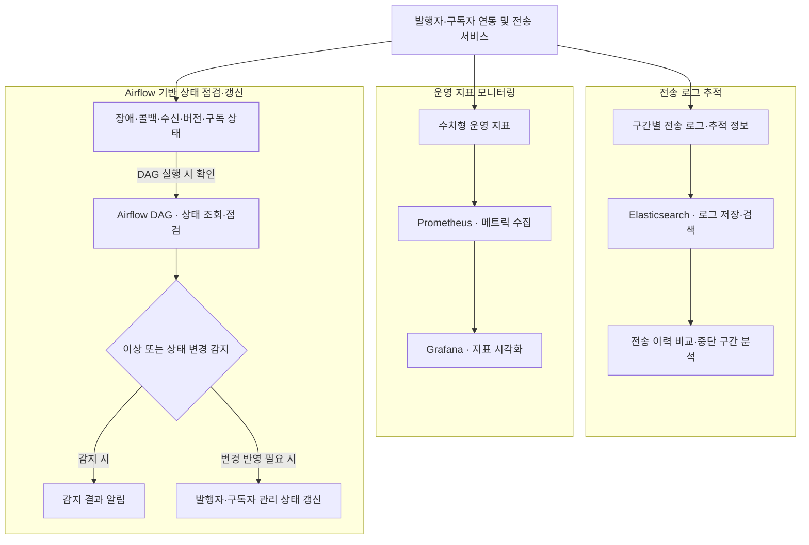
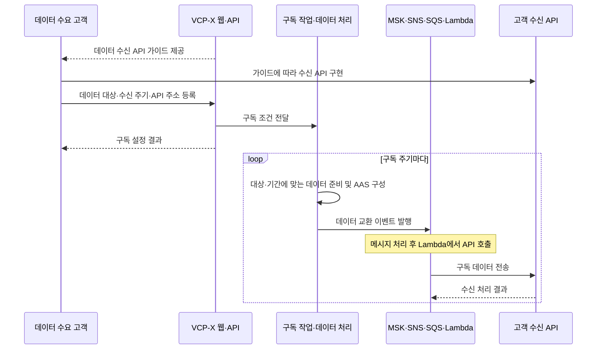

VCP-X
제조 데이터 표준화 및 기업 간 데이터 교환 플랫폼
여러 공장의 설비·시스템에서 수집한 데이터를 공통 구조로 정리하고, 필요한 기업에 주기적으로 전달하는 웹 기반 데이터 플랫폼입니다. 데이터를 제공하는 공장과 이를 활용하는 공장·리포트 생성 고객 사이의 수집, 표준화, 보관, 구독 및 API 연계를 개발했습니다.
공장별로 다른 원천 데이터를 Avro 스키마 기반의 공통 메시지로 변환해 처리하고, 외부 교환 시에는 AAS 기반 데이터 모델로 구성합니다. 고객은 API 가이드에 따라 수신 API를 구현하며, 플랫폼은 구독 조건에 맞춰 데이터를 준비한 뒤 MSK·SNS·SQS·Lambda를 거쳐 고객 API로 전달합니다. 이 데이터를 DPP·PCF 정보 구성과 탄소배출 리포트 분석에 활용합니다.
전송 단계가 여러 서비스에 걸쳐 있어 Elasticsearch로 전송 로그와 추적 정보를 분석하고, 데이터 전달이 어느 구간에서 중단됐는지 확인했습니다. Airflow DAG에서는 발행자·구독자의 장애, 콜백 응답, 데이터 수신, Agent 버전 및 구독 상태를 점검하고, 이상이나 변경이 감지되면 알림과 상태 갱신을 처리했습니다.
> 프로젝트의 주요 구조와 담당 개발 범위를 정리한 문서입니다. 설계도는 처리 역할을 기준으로 단순화한 논리 구조이며, 스키마와 저장 경로는 이해를 돕기 위한 예시입니다.
프로젝트 배경
같은 제조 데이터라도 공장마다 필드명, 자료형, 단위와 제공 방식이 달랐습니다. 수요 기업이 공장별 형식을 직접 해석해야 하는 구조에서는 데이터 제공처나 활용 서비스가 추가될 때마다 개별 연동이 필요했습니다.
VCP-X에서는 공장과 고객 사이에 공통 데이터 처리 계층을 두었습니다.
데이터 제공 공장: Agent를 통해 설비 데이터를 수집하고 플랫폼으로 전송합니다.
VCP-X: 공장별 데이터를 표준화하고, 보관·가공한 뒤 구독 조건에 맞게 제공합니다.
데이터 수요 고객: 필요한 데이터와 수신 주기를 요청하고, 자체 수신 API에서 데이터를 받아 생산 시스템이나 리포트 생성에 활용합니다.
데이터를 제공하는 기업이 다른 기업의 데이터를 구독하는 수요 고객이 될 수도 있습니다.
전체 아키텍처
데이터 수집·교환 흐름

수집 이벤트와 데이터 교환 이벤트는 MSK의 역할을 구분해 표현한 것으로, 별도 클러스터를 의미하지 않습니다.
`공통 필드 매핑·Avro 변환`, `구독 작업 실행`, `전달 처리 서비스`는 논리적인 처리 역할입니다. Agent와 플랫폼 사이의 배치 위치나 실제 서비스 수를 나타내지 않습니다.
전달 구간은 MSK 이벤트를 소비하는 처리 계층과 SNS·SQS·Lambda를 연결한 논리 구조로 표현했습니다. 구독 주기는 플랫폼의 작업 실행 계층이 관리하며, SNS·SQS는 준비된 전달 작업을 비동기로 연결합니다.
운영 관측·상태 점검 흐름
전송 이력을 추적하는 로그 분석, 수치형 운영 지표 모니터링, 발행자·구독자 상태를 점검하는 DAG를 다음과 같이 구분했습니다.

Elasticsearch: 전송 로그와 추적 정보를 조회해 데이터 전달이 중단되거나 실패한 구간을 분석합니다.
Prometheus·Grafana: 운영 메트릭을 수집하고 시각화합니다. 로그 분석과 메트릭 모니터링을 함께 활용하는 구조입니다.
Airflow: DAG 실행 시 발행자·구독자 상태를 점검하고, 이상 또는 상태 변경이 감지되면 알림과 상태 갱신을 처리합니다.
그림은 역할별 논리 흐름입니다. 로그 수집 방식, 메트릭 연계 방식, 상태 조회 대상 및 알림 채널의 세부 구현은 생략했습니다.
주요 기능과 개발 내용
1. OPC UA 기반 공장 Agent
데이터 수집의 시작점에 공장 Agent를 두고, OPC UA를 통해 설비·시스템에서 발생한 원천 데이터를 읽어 플랫폼으로 전송했습니다. OPC UA는 설비 데이터에 접근하는 통신 방식이며, 실제 측정값은 연결된 설비나 시스템에서 생성됩니다.
공장 설비와 연결하는 OPC UA 기반 데이터 수집 Agent 개발
공장별 원천 데이터를 플랫폼의 공통 데이터 구조에 매핑
Spring for Apache Kafka 기반 Data Agent와 Amazon MSK를 이용한 수집 이벤트 전송
Java·Spring Boot 및 Python 기반 수집·가공·적재 파이프라인과 마이크로서비스 개발
2. Avro 기반 내부 데이터 표준화
공장마다 다른 원천 데이터를 플랫폼에서 동일한 구조로 처리하도록 공통 필드와 타입을 정의하고 Avro 스키마로 표현했습니다. 필드명·단위 등 공장별 차이를 맞추는 것은 매핑·변환 로직의 역할이며, Avro는 변환된 데이터의 스키마와 직렬화 형식을 담당합니다.
예를 들어 두 공장의 전력량 데이터를 다음과 같이 공통 모델로 정리할 수 있습니다.
항목	공장 A 원천 데이터 예시	공장 B 원천 데이터 예시	플랫폼 공통 모델 예시
설비 식별자	`machine_id`	`equipmentCode`	`assetId`
측정 항목	`energy_kwh`	`energyWh`	`metric = energy_consumption`
측정값	`12.5` kWh	`12500` Wh	`value = 12.5`, `unit = kWh`
측정 시각	`measured_at`	`timestamp`	`measuredAt`
필드 이름을 맞추는 것과 함께 데이터의 의미·측정 구간·단위를 맞춰야 합니다. 위 표는 동일한 측정 구간의 전력량을 가정한 예시입니다.
<details>
<summary>공통 측정 이벤트의 Avro 스키마 예시</summary>
아래 스키마는 내부 메시지 구조를 설명하기 위한 예시이며, 운영 스키마를 그대로 옮긴 것은 아닙니다.
```json
{
  "type": "record",
  "name": "ManufacturingMeasurement",
  "namespace": "example.vcpx",
  "fields": [
    { "name": "eventId", "type": "string" },
    { "name": "companyId", "type": "string" },
    { "name": "factoryId", "type": "string" },
    { "name": "assetId", "type": "string" },
    { "name": "metric", "type": "string" },
    { "name": "value", "type": "double" },
    { "name": "unit", "type": "string" },
    {
      "name": "measuredAt",
      "type": { "type": "long", "logicalType": "timestamp-millis" }
    }
  ]
}
```
`companyId`와 `factoryId`는 이 예시에서 데이터 제공 기업과 공장을 구분합니다. `measuredAt`은 UTC 기준 Unix epoch 이후의 밀리초로 표현합니다.
</details>
3. AAS 기반 데이터 모델링과 기업 간 교환
플랫폼 내부에서 처리한 제조 데이터를 외부 기업이 자산·제품의 맥락과 함께 이해할 수 있도록 AAS(Asset Administration Shell) 기반으로 모델링하고 파싱하는 기능을 구현했습니다.
Avro와 AAS는 서로 다른 역할을 맡습니다.
구분	Avro	AAS
주요 목적	플랫폼 내부 메시지의 구조와 타입 정의·직렬화	자산·제품에 관한 정보의 구조와 의미 표현
적용 구간	공장 데이터의 플랫폼 유입과 내부 이벤트 처리	가공된 제조 정보를 외부 기업에 제공하는 구간
처리 내용	공통 필드에 맞춘 데이터 표현	자산 식별 및 관련 정보를 Submodel로 구성
AAS 구성은 내부 필드를 단순히 이름만 바꾸는 작업이 아니라, 어떤 자산에 속한 어떤 정보인지 매핑하는 과정입니다. 고객의 데이터 활용 목적에 맞춰 필요한 정보를 구성해 전달합니다.
4. 데이터 구독과 주기적 API 전달
고객은 필요한 데이터를 요청하고 수신 주기를 지정합니다. 플랫폼에서 제공하는 API 가이드를 바탕으로 고객이 수신 API를 준비하면, VCP-X가 정해진 주기에 해당 API를 호출해 데이터를 전달합니다.

그림에서 전달 구간의 각 구성요소는 다음 역할을 맡습니다.
구성요소	담당 역할
구독 관리·작업 실행	고객의 요청 조건과 주기에 따라 전달할 데이터 준비
Amazon MSK	플랫폼 내부 데이터 교환 이벤트 전달
전달 처리 서비스	MSK 이벤트를 소비하고 SNS 전달 이벤트 발행
Amazon SNS	전달 이벤트를 구독된 SQS로 전파
Amazon SQS	Lambda가 처리할 전달 작업 보관
AWS Lambda	전달 작업을 처리하고 고객 수신 API 호출
고객 수신 API	전달 데이터를 받아 고객 시스템에서 활용
이때 VCP-X의 고객 데이터 구독과 SNS의 메시지 구독은 별개입니다. 고객의 데이터 대상·주기는 플랫폼에서 관리하고, SNS 구독은 전달 이벤트를 연결하는 인프라 구성입니다.
고객별 API 가이드에는 데이터 구조, 필드 의미, 인증 방식과 수신 응답 규격이 필요합니다. 재전송에 대비한 식별자·중복 처리 방식 등 세부 계약은 실제 연동 규격에 맞춰 정의합니다. 이 문서에서는 특정 인증 방식이나 재시도 정책을 운영 구현으로 가정하지 않습니다.
5. 고객·공장별 데이터 보관
제조 데이터를 Amazon S3에 보관하고, 데이터 제공 고객·공장 단위로 구분해 관리했습니다. 보관한 데이터는 구독 조건에 맞는 데이터 제공과 후속 처리에 활용했습니다.
아래는 고객과 공장을 구분하는 S3 객체 경로의 예시입니다.
```text
s3://example-vcp-x-data/company-a/factory-01/date=2026-01-01/...
s3://example-vcp-x-data/company-a/factory-02/date=2026-01-01/...
s3://example-vcp-x-data/company-b/factory-01/date=2026-01-01/...
```
예시의 `company-*`는 데이터 제공 기업을 의미합니다. 실제 버킷 수, 객체 경로, 보관 형식 및 접근 제어 정책은 운영 구성에 따라 달라집니다.
6. Elasticsearch 기반 전송 로그 분석과 구간 추적
데이터가 공장 Agent, 플랫폼 처리 서비스, 메시징 계층, 고객 API 전달 구간을 거치기 때문에 최종 수신 여부만으로는 문제가 발생한 위치를 파악하기 어려웠습니다. 각 전송 구간의 로그와 추적 정보를 Elasticsearch에서 조회해 처리 흐름을 확인하고, 어느 지점에서 전달이 끊겼는지 분석할 수 있도록 했습니다.
전송 구간별 로그와 추적 정보를 모아 처리 이력 확인
동일한 데이터 전달 흐름의 단계별 기록을 비교해 중단·실패 구간 파악
전송 이력과 응답·콜백 기록을 확인해 미수신 문제 분석
Prometheus·Grafana 기반 운영 지표 모니터링과 함께 장애 원인 조사에 활용
예를 들어 앞 단계의 전송 기록은 있지만 다음 단계의 수신·처리 기록이 확인되지 않으면, 해당 구간을 우선 조사할 수 있습니다. 이때 로그 누락이나 지연 가능성도 함께 확인해야 하므로 기록 부재만으로 전송 실패를 확정하지 않습니다.
Elasticsearch는 전송 로그·추적 정보 분석, Prometheus는 수치형 메트릭 모니터링을 맡는 것으로 구분합니다. 제조 원천 데이터의 보관은 S3에서 담당합니다.
7. Airflow DAG 기반 발행자·구독자 상태 관리
Apache Airflow에서 실행되는 DAG를 통해 데이터 발행자와 구독자의 상태를 점검했습니다. 각 DAG의 점검 작업에서 장애 여부와 데이터 전달 상태를 확인하고, 이전 상태와 비교해 변경 사항을 반영했습니다.
점검 항목	확인 내용
발행자·구독자 장애	각 발행자·구독자의 장애 또는 비정상 상태 여부
콜백 응답	전송 처리에 대한 콜백 응답이 확인되는지 여부
데이터 수신	구독자가 데이터를 받지 못하고 있는지 여부
Agent 버전	점검 대상 Agent의 버전 차이 여부
구독 상태 전환	구독 상태가 구독 취소 등으로 변경됐는지 여부
이상이나 상태 변경이 감지되면 알림을 전달하고, 점검 결과에 맞춰 발행자·구독자의 관리 상태를 갱신했습니다. 이를 통해 전송 문제와 구독 상태 변화를 운영 과정에서 확인하고 반영할 수 있도록 했습니다.
여기서 콜백은 데이터 전송과 관련된 응답을 의미합니다. 상태 확인은 DAG 실행 시 수행하고, 알림과 상태 갱신은 변경 감지 후 즉시 처리하는 흐름입니다. 감지 시점은 DAG의 실행 주기와 작업 처리 시간에 따라 달라집니다.
8. 실시간·배치 처리와 DPP·PCF 활용
수집 데이터를 실시간으로 가공하는 흐름과 배치로 처리하는 흐름을 구성했습니다.
Apache Flink: 실시간 스트림 데이터 처리
Apache Airflow: 배치·ETL 워크플로우 구성 및 발행자·구독자 상태 점검 DAG 운영
Python·Kafka: 이벤트 처리 및 모니터링
DPP·PCF 데이터 구성: 수집·가공한 제조 정보를 목적에 맞게 구성하고 기업 간 교환에 활용
**DPP(Digital Product Passport, 디지털 제품 여권)**는 제품 관련 정보를 연결하는 활용 영역이며, **PCF(Product Carbon Footprint, 제품 탄소발자국)**는 제품의 탄소배출 관련 정보를 다루는 활용 영역입니다. 이 문서의 범위는 해당 정보를 만들고 교환하기 위한 데이터 처리 구조입니다. 구체적인 탄소 산정식이나 인증·검증 범위는 포함하지 않습니다.
9. 탄소배출 리포트 분석 AI Agent
데이터 수집·교환 기능과 함께, 제조 데이터를 활용하는 리포트 분석 기능을 개발했습니다.
Amazon Bedrock을 이용한 탄소배출 리포트 분석
LangGraph를 이용한 데이터 조회·LLM 호출 워크플로우 구성
Tool Calling / Function Calling을 활용한 외부 API 및 데이터 연계
Python 기반 데이터 처리와 분석 흐름 연결
LLM은 리포트의 해석과 설명 생성에 활용하고, 분석에 필요한 데이터는 연결된 API와 도구를 통해 조회하는 구조입니다.
웹서비스와 운영 기반
데이터 플랫폼의 수집·처리 기능뿐 아니라 사용자가 접근하는 웹서비스와 운영 환경도 함께 개발했습니다.
React·Node.js 기반 VCP-X 웹서비스 및 RESTful API 개발
Keycloak 기반 사용자 인증·인가 체계 구축
PostgreSQL 데이터 모델 설계와 API 개발
Redis·Jedis를 이용한 데이터 교환 처리와 서비스 간 데이터 연계
Elasticsearch·ELK 기반 전송 로그 분석 및 구간별 추적 환경 구축
Prometheus·Grafana 기반 운영 지표 모니터링 환경 구축
Airflow DAG 기반 발행자·구독자 상태 점검, 이상 알림 및 상태 변경 처리
개발팀 코드 리뷰와 기술 이슈 검토
기술 스택
영역	사용 기술	주요 적용 내용
웹서비스	React, Node.js	웹 기능 및 RESTful API
백엔드·Agent	Java, Spring Boot, Spring for Apache Kafka	수집 Agent, ETL, 마이크로서비스, 이벤트 연계
데이터 처리·AI	Python	데이터 가공, 배치 처리, 리포트 분석·AI Agent
설비 연동	OPC UA	공장 설비·시스템 데이터 수집
데이터 표현	Apache Avro, AAS	내부 공통 스키마 및 자산 기반 교환 모델

메시징	Apache Kafka, Amazon MSK	수집·교환 이벤트 스트리밍
스트림 처리	Apache Flink	실시간 스트림 데이터 처리
배치·상태 관리	Apache Airflow	ETL 워크플로우, 상태 점검 DAG, 이상 알림 및 상태 갱신
고객 전달	Amazon SNS, Amazon SQS, AWS Lambda	비동기 작업 전달 및 고객 API 호출
데이터 저장	Amazon S3, PostgreSQL	고객·공장별 제조 데이터 보관 및 서비스 데이터 모델
전송 로그·추적	Elasticsearch, ELK	전송 이력 검색·분석 및 중단 구간 파악
서비스 연계	Redis, Jedis	데이터 교환 기능과 서비스 간 연계
인증·인가	Keycloak	사용자 인증과 접근 권한 관리
AI 워크플로우	Amazon Bedrock, LangGraph	리포트 분석, Tool Calling 기반 외부 데이터 활용
메트릭 모니터링	Prometheus, Grafana	수치형 운영 지표 수집 및 시각화
설계에서 중점을 둔 부분
공장별 차이를 수집·표준화 구간에서 처리  
원천 데이터의 차이를 공통 모델로 정리해, 이후 처리 서비스와 고객이 공장별 형식을 반복해서 해석하지 않도록 했습니다.
내부 처리 모델과 외부 교환 모델의 역할 구분  
Avro는 공통 이벤트 구조와 직렬화를, AAS는 자산·제품 맥락을 포함한 정보 모델을 담당하도록 구성했습니다.
데이터 수집과 고객 전달의 비동기 연결  
MSK를 중심으로 데이터 처리 흐름을 연결하고, SNS·SQS·Lambda를 이용해 고객 API 호출 구간을 분리했습니다.
고객 구독 조건에 따른 데이터 제공  
데이터가 들어오는 시점과 고객이 요청한 전달 주기를 구분해, 필요한 데이터를 준비하고 정기적으로 제공하는 흐름을 구성했습니다.
전송 구간을 따라 문제 지점 확인  
Elasticsearch에서 구간별 전송 로그와 추적 정보를 확인해, 어느 단계까지 처리됐고 어느 구간을 조사해야 하는지 파악할 수 있도록 했습니다.
발행자·구독자 상태 변화의 운영 반영  
Airflow DAG에서 장애, 콜백 응답, 데이터 수신, Agent 버전 및 구독 상태를 점검하고, 감지 결과를 알림과 관리 상태 갱신으로 연결했습니다.
참고 문서
기술 개념과 역할을 확인할 수 있는 공식 문서입니다. 링크의 버전이 프로젝트의 사용 버전을 뜻하지는 않습니다.
Apache Avro Specification — 스키마와 직렬화
IDTA — Asset Administration Shell
Amazon SNS — SQS 구독과 메시지 전달
AWS Lambda — SQS 이벤트 소스 연동
Apache Airflow — DAG와 작업 실행 구조
Prometheus — 메트릭 기반 모니터링 개요
